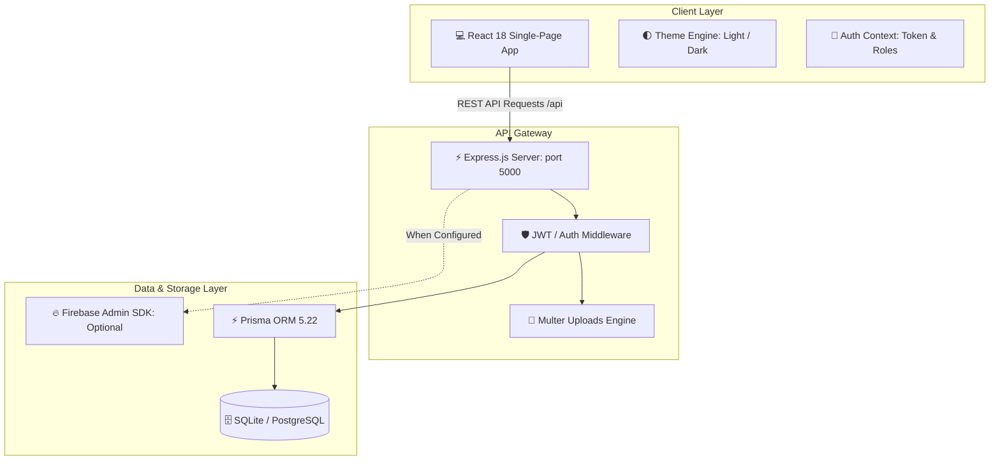
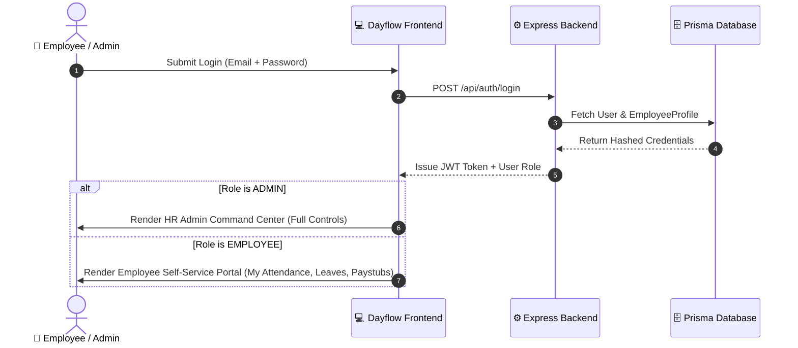

# 🌿 Dayflow HRMS
### Next-Generation Human Resource Management & Employee Operations Platform

<div align="center">

[](https://react.dev/)
[](https://expressjs.com/)
[](https://www.prisma.io/)
[](https://sqlite.org/)
[](https://firebase.google.com/)
[](./LICENSE)

**A modern, intuitive, and frictionless workplace management platform engineered for high-performing teams.**

[Overview](#-overview) • [Key Modules](#-key-modules) • [Architecture](#-system-architecture) • [Demo Credentials](#-demo-credentials) • [Getting Started](#-getting-started) • [API Reference](#-api-endpoints) • [Security](#-security--credentials-safety)

---

</div>

## 🚀 Overview

**Dayflow** is a full-stack Human Resource Management System (HRMS) built to replace clunky legacy HR software with a fast, modern, and beautiful interface. 

It handles the entire employee lifecycle—from onboarding and live biometric clock-in/out to leave approval pipelines and salary slip generation. Built with a warm, bespoke design system (featuring sage greens, warm cream surfaces, and full dark-mode support), Dayflow makes everyday company operations effortless for both **HR Administrators** and **Employees**.

---

## ⚡ Key Modules & Features

```
┌─────────────────────────────────────────────────────────────────────────────┐
│                              DAYFLOW PLATFORM                               │
├──────────────────────┬──────────────────────┬───────────────────────────────┤
│ 👥 Employee Directory│ ⏱️ Attendance Engine  │ 📅 Leave Portal               │
│ • Full CRUD Profiles │ • Real-Time Clock In │ • Paid / Sick / Casual Leaves │
│ • Job & Department   │ • Daily Hours Auto   │ • Admin Approval Pipeline     │
│ • Document Vault     │ • Status Indicators  │ • Status Feedback & History   │
├──────────────────────┼──────────────────────┼───────────────────────────────┤
│ 💰 Payroll System    │ 🔐 Dual Authentication│ 🌓 Aesthetic UI & Dark Mode   │
│ • Salary Breakdowns  │ • Firebase Auth (Opt)│ • Bespoke Sage Theme (#2D4A3E)│
│ • Allowances/Deducts │ • Local JWT + bcrypt │ • 1-Click Dark/Light Switch   │
│ • Printable Paystubs │ • Auto Email Verify  │ • Responsive Tablet/Mobile UI │
└──────────────────────┴──────────────────────┴───────────────────────────────┘
```

### 1. 👥 Employee Directory & Profile Management
- Complete searchable employee records categorized by department, role, and employment status.
- Rich profile views: contact info, job title, join date, base salary, and uploaded identity/contract documents.
- Admin controls to edit employee details, promote roles, or adjust compensation structures.

### 2. ⏱️ Real-Time Attendance & Work Tracking
- Simple **1-click clock-in and clock-out** directly from the employee dashboard.
- Automatic daily working hour computation with overtime calculation.
- Status badges: `PRESENT`, `ABSENT`, `HALF_DAY`, and `LEAVE`.
- Historical calendar breakdown of monthly attendance logs.

### 3. 📅 Leave Management & Approval Pipelines
- Employees can request leaves with custom date ranges, leave categories (`PAID`, `SICK`, `UNPAID`), and detailed notes.
- Dedicated HR approval modal with **Approve** and **Reject** buttons, including admin feedback comments.
- Instant balance tracking showing remaining vacation and sick days.

### 4. 💰 Payroll Records & Paystub Generation
- Automated calculation of **Net Salary** = `Base Salary` + `Allowances` - `Deductions`.
- Monthly payroll history cards for each employee showing payout dates and payment status (`PAID`, `PENDING`).
- Formatted paystub summaries ready for review and printing.

### 5. 🔐 Dual-Layer Security & Hybrid Authentication
- **Zero-Config Local Mode**: Runs right out of the box using secure local JWTs and `bcrypt` password hashing.
- **Firebase Auth Support**: Plug in your Firebase project credentials to enable Google OAuth and Firebase Email Authentication.
- Role-based route protection separating **HR Admin Operations** from **Employee Self-Service**.

---

## 🔄 System Architecture



### Role-Based Access Control Flow



---

## 🔑 Demo Credentials

Dayflow includes a pre-seeded database with realistic company data so you can test both Admin and Employee roles immediately:

| Role | Email | Password | Name & Job Title |
| :--- | :--- | :--- | :--- |
| **👑 HR Admin** | `admin@dayflow.com` | `Password123!` | **Sarah Jenkins** (HR Director) |
| **💼 Employee** | `alex@dayflow.com` | `Password123!` | **Alex Rivera** (Senior Software Engineer) |
| **💼 Employee** | `jordan@dayflow.com` | `Password123!` | **Jordan Lee** (HR Specialist) |
| **💼 Employee** | `taylor@dayflow.com` | `Password123!` | **Taylor Swift** (Product Designer) |

---

## 🏁 Getting Started

### Prerequisites
- Node.js `>= 18.0.0`
- npm `>= 9.0.0`

### 1. Clone & Setup
```bash
git clone https://github.com/adityapritam/Dayflow.git
cd Dayflow
```

### 2. Install Dependencies
Install dependencies for both backend and frontend:
```bash
# Backend dependencies
cd backend
npm install

# Frontend dependencies
cd ../frontend
npm install
cd ..
```

### 3. Initialize & Seed Database
Setup the SQLite database with one command:
```bash
cd backend
npx prisma db push
npx prisma db seed
cd ..
```

### 4. Start Development Servers
Open two terminal windows:

**Terminal 1 (Backend API - Port 5000):**
```bash
cd backend
npm run dev
```

**Terminal 2 (Frontend Client - Port 3000):**
```bash
cd frontend
npm run dev
```

Visit **`http://localhost:3000`** in your browser to access Dayflow! 🎉

---

## 📡 API Endpoints

| Method | Endpoint | Description | Auth Required |
| :--- | :--- | :--- | :--- |
| `POST` | `/api/auth/login` | Authenticate user & issue JWT | No |
| `POST` | `/api/auth/register` | Register new employee account | No |
| `GET` | `/api/auth/me` | Fetch active user session profile | Bearer Token |
| `GET` | `/api/employees` | List all employees (Search & Filter) | Bearer Token |
| `GET` | `/api/employees/:id` | Fetch detailed employee dossier | Bearer Token |
| `PUT` | `/api/employees/:id` | Update profile, role, or salary | Admin Only |
| `GET` | `/api/attendance/today`| Get logged-in user's attendance | Bearer Token |
| `POST` | `/api/attendance/check-in` | Clock in for the current day | Bearer Token |
| `POST` | `/api/attendance/check-out`| Clock out and record total hours | Bearer Token |
| `GET` | `/api/leaves/my` | View logged-in user's leave requests| Bearer Token |
| `POST` | `/api/leaves/apply` | Submit new leave application | Bearer Token |
| `PUT` | `/api/leaves/:id/status`| Approve or reject leave request | Admin Only |
| `GET` | `/api/payroll/my` | View personal salary history | Bearer Token |
| `POST` | `/api/payroll/create` | Issue new payroll entry | Admin Only |
| `GET` | `/api/admin/metrics` | Community & HR analytics overview | Admin Only |

---

## 🛡️ Security & Credentials Safety

- **No Secrets in Source**: All sensitive credentials (`.env`, private keys, database files) are strictly excluded via `.gitignore`.
- **Pre-Configured Safe Defaults**: The repository uses safe placeholder templates (`.env.example`) so anyone can clone and run without accidental credential exposure.
- **Password Protection**: All passwords are salted and hashed using `bcryptjs` with cost factor 10.
- **CORS & Input Sanitization**: Protected API routes with token validation and role-based access checks.

---

<div align="center">
  <b>Dayflow HRMS — Crafted for seamless workplace management.</b>
</div>

